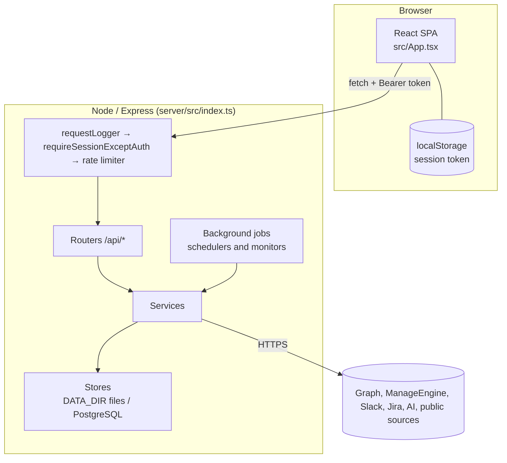
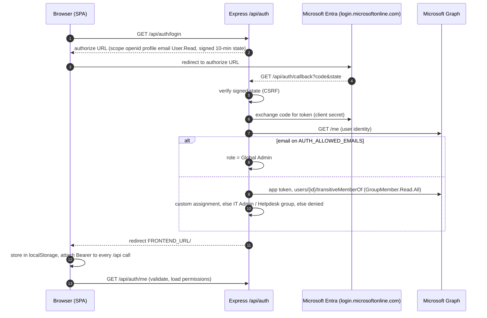
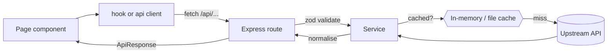
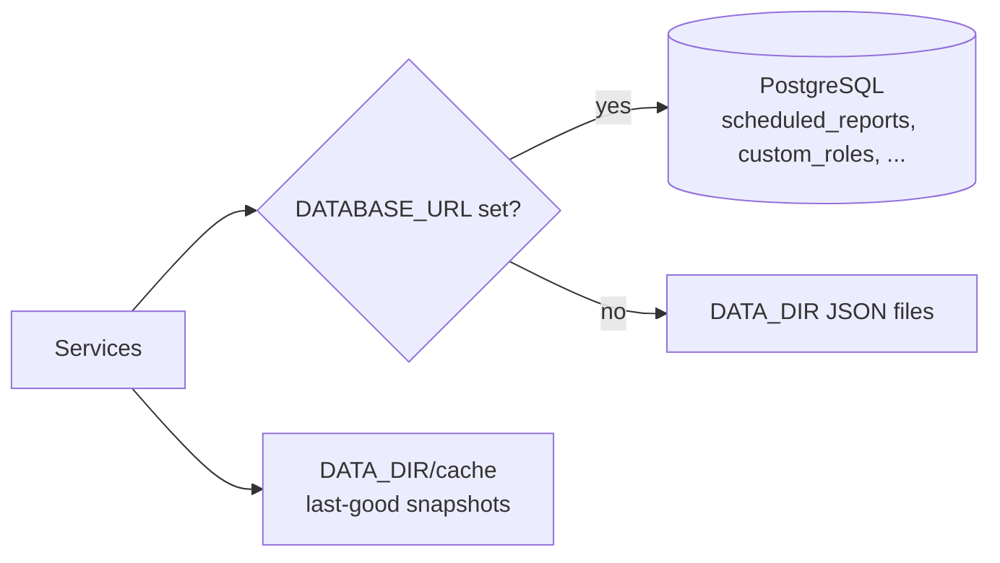
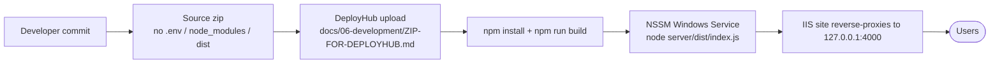
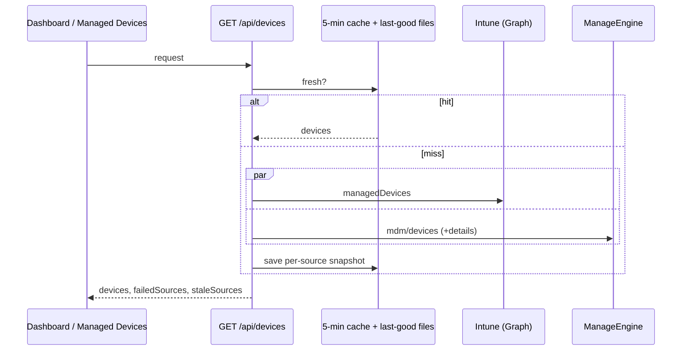
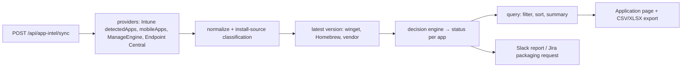
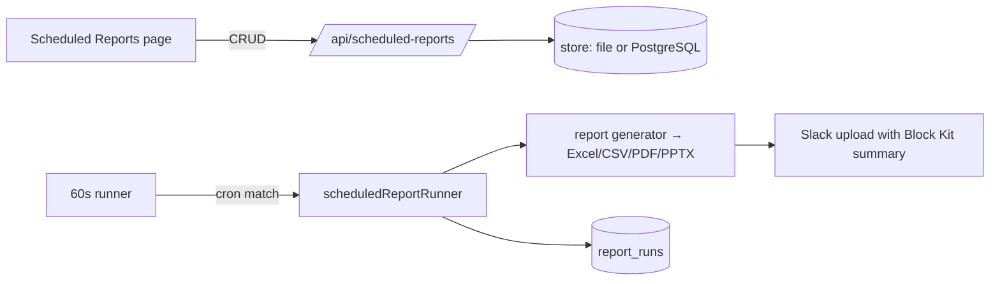
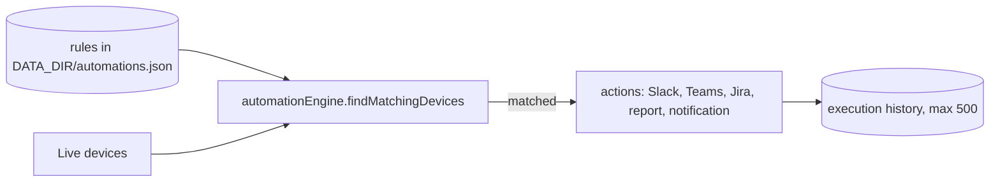
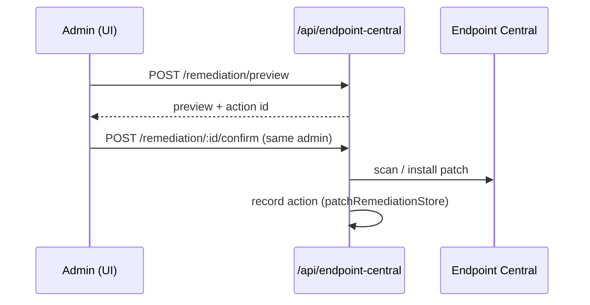

# 02 — Architecture and Application Logic

> See [01 — Overview](01-project-overview.md) for context. Labels: **Verified / Inferred / Not verified**.

## 1. Runtime topology

One Node.js process serves both the JSON API (`/api/*`) and, when `dist/` exists next to the server build, the compiled React SPA with an `index.html` fallback for client-side routes. *(Verified: `server/src/index.ts`, lines "Serve the built frontend".)* In development, Vite serves the SPA on port 5173 and proxies `/api` to `http://localhost:4000` (`vite.config.ts`).

## 2. Request pipeline (server)

Verified from `server/src/index.ts`:

1. `app.set('trust proxy', 1)` — correct client IP behind IIS/ARR.
2. `cors()` (all origins), `express.json()`, `requestLogger`.
3. `GET /health` → `{ status: 'healthy', timestamp }` (unauthenticated).
4. `/api/mac-admin-access` **ingest** router is mounted **before** the session gate; it authenticates with a shared secret header `x-report-key` (`MAC_ADMIN_REPORT_KEY`).
5. `app.use('/api', requireSessionExceptAuth)` — every `/api` path except `/api/auth/*` needs a valid Bearer token. The middleware **overwrites** `x-user-email` / `x-user-role` with values taken from the verified token, so a client cannot spoof them.
6. Routers are mounted, most with `apiLimiter` (15-minute window; 200 requests in production, 2000 in development, per IP).
7. SPA static files and fallback, then `errorHandler` (Zod errors → HTTP 400; others → status or 500 with `{ success:false, error }`; stack included only when `NODE_ENV=development`).

Standard response envelope: `{ success: boolean, data?: T, error?: string }` (`ApiResponse` in `server/src/types.ts`).

## 3. Authentication flow

Details and security analysis: [06 — Authentication, RBAC and security](06-authentication-rbac-security.md).

## 4. Frontend → backend communication

- A single `fetch` wrapper in `src/api/session.ts` adds `Authorization: Bearer <token>` to `/api` requests and signals expired sessions (HTTP 401) so the `AuthGate` returns to the login screen. *(Verified.)*
- `src/api/index.ts` holds the main typed API client; feature clients live next to it (`appIntel.ts`, `copilot.ts`, `staleDevices.ts`, `roles.ts`, …). Base URL: `VITE_API_URL` or same-origin relative paths.
- Page access is decided client-side by `canAccess()` in `src/lib/permissions.ts` using the permission map delivered by `/api/auth/me` through `PermissionsContext`, and server-side by `requireCapability(key)` on selected routes. **The two are not equivalent**; see the gap list in [06 §6](06-authentication-rbac-security.md).

## 5. Data fetching, caching and fallback (Verified)

| Concern | Behaviour | Code |
|---|---|---|
| Device list | Intune and ManageEngine fetched in parallel with a 30 s per-source timeout; merged; cached in memory for 5 min | `routes/devices.ts` (`CACHE_TTL_MS`, `SOURCE_FETCH_TIMEOUT_MS`) |
| Source failure | The failed source is listed in `failedSources`; the **last-good list for that source** (saved to `DATA_DIR/cache/devices-<source>.json`) is served and the source is reported in `staleSources`. An empty result never overwrites a good snapshot | `store/deviceSnapshotStore.ts`, `routes/devices.ts` |
| Warm start | After a restart the first request is answered from the saved lists while a background refresh runs | `routes/devices.ts` (`loadWarmStart`) |
| Graph retries | 429 and 5xx retried with `Retry-After` (capped at 120 s) or jittered back-off; timeouts retried; 4xx raises a fatal error with a sanitised message | `services/graphApi.ts` (`fetchWithRetry`) |
| Throttled large reads | `detectedApps` read is paced, resumable and cooled-down between rounds; last good read saved | `services/appIntel/providers.ts`, `graphApi.ts` (`graphGetAllResumable`) |
| Slack health | Polled every 5 min (15 min when degraded) with 10 s/30 s/90 s retry back-off | `services/slackHealth.ts` |
| Users list | 5-minute in-memory cache | `routes/users.ts` |
| Data-quality warnings | Reports and the digest append checks (source completeness, freshness, reconciliation) so partial data is labelled, not silent | `services/dataQuality.ts`, `fleetDataQuality.ts` |
| UI states | Pages show loading, error-with-retry and "last synced" states; stale/partial banners come from the API | e.g. `src/pages/AppIntelligencePage.tsx` |

## 6. Background jobs (started in `server/src/index.ts`)

| Job | Interval | Purpose | File |
|---|---|---|---|
| Slack health monitor | 5 min (15 min degraded) | `auth.test` health + status | `services/slackHealth.ts` |
| Scheduled report runner | 60 s tick, cron match (timezone aware) | Runs due scheduled reports | `services/scheduledReportRunner.ts` |
| Automation scheduler | 60 s tick | Runs `scheduled` automation rules | `services/automationScheduler.ts` |
| Notification scheduler | `NOTIFICATION_SCHEDULER_POLL_SECONDS` | Claims due Slack notification schedules | `services/notificationScheduler.ts` |
| Verified app release monitor | 6 h default (min 15 min) | Polls approved version sources, weekly digest | `services/appIntel/releaseMonitor.ts` |
| Security inventory warm-up | at start | Pre-computes coverage data | `routes/securityInventory.ts` |

All jobs are **in-process**: running two instances would run each job twice (the notification claim is DB-based only when PostgreSQL is used). *(Inferred from the single-process design; see [10](10-risks-limitations-technical-debt.md).)*

## 7. Persistence layers

Details: [09 — Database and data handling](09-database-and-data-handling.md).

## 8. Deployment flow

*(Verified for IIS/NSSM files and the zip SOP; the DeployHub platform itself is **Not verified**.)* Full procedures: [08 — Deployment and operations](08-deployment-and-operations.md).

## 9. Major module workflows

### 9.1 Device inventory and dashboard

### 9.2 Application Security & Compliance (App Intelligence)

### 9.3 Scheduled reports and Slack digest

### 9.4 Automation engine

### 9.5 Patch operations (Endpoint Central)

Per-module detail: [04 — Modules and code logic](04-modules-and-code-logic.md).
