# Mac Devices

> **Platform:** Kandji MDM · macOS  
> **Navigation:** Endpoint Management → Mac Devices

The **Mac Devices** module is the central command center for managing your entire macOS fleet through Kandji. It surfaces real-time device health, FileVault encryption status, EDR coverage, compliance state, and managed application inventory — all in a single, structured interface.

---

## Table of Contents

1. [Overview Dashboard](#1-overview-dashboard)
2. [Devices Tab](#2-devices-tab)
3. [App Library Tab](#3-app-library-tab)
4. [Security Tab](#4-security-tab)
5. [Automation Tab](#5-automation-tab)
6. [Reports Tab](#6-reports-tab)
7. [Device Detail Panel](#7-device-detail-panel)
   - [Overview](#71-overview-tab)
   - [Hardware](#72-hardware-tab)
   - [Network](#73-network-tab)
   - [Security](#74-security-tab-1)
   - [Apps](#75-apps-tab)
   - [Compliance](#76-compliance-tab)
8. [Device Lookup (Cross-Platform)](#8-device-lookup)

---

## 1. Overview Dashboard


When you navigate to **Mac Devices**, the page greets you with a live summary bar showing your fleet's key health indicators at a glance.

### Fleet Health KPI Cards

| KPI | Description |
|-----|-------------|
| **Total Macs** | Total number of macOS devices managed via Kandji |
| **FileVault On** | Percentage of devices with full-disk encryption enabled |
| **EDR Active** | Percentage of devices running an active EDR agent (e.g., CrowdStrike) |
| **Compliant** | Count of devices passing all MDM compliance checks |
| **Needs Attention** | Count of devices with active compliance issues or security gaps |

> Each KPI card is **clickable** — selecting it opens a pre-filtered device view showing only the relevant device subset (e.g., clicking "Needs Attention" shows all non-compliant devices).

### Page Header Controls

| Control | Function |
|---------|----------|
| **← Dashboard** | Returns to the main ITO Endpoint dashboard |
| **+ Add Device** | Opens a form to manually enroll a new macOS device |
| **Refresh** | Re-fetches live device data from Kandji API |
| **Subtitle** | Displays the data source — "Managed by Kandji — device, application & security reports" |

---

## 2. Devices Tab

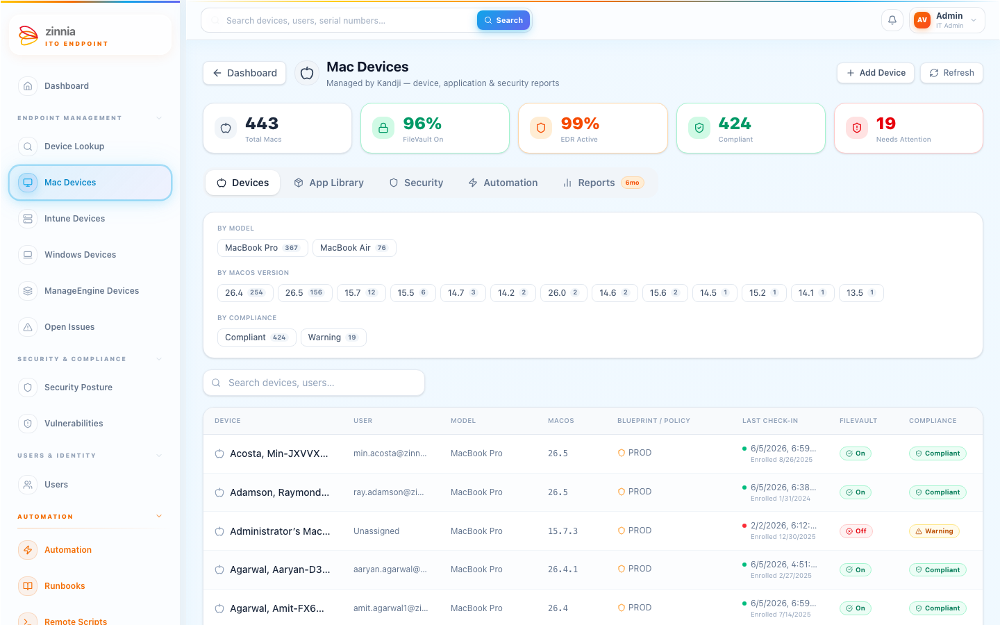

The **Devices** tab is the primary fleet inventory view. It provides a filterable, searchable, and resizable table of every enrolled macOS device.

### Quick Filters

Three filter groups appear above the table:

#### By Model
Displays the distribution across Mac hardware form factors. Click any chip to filter the table instantly:

| Filter | Example Count |
|--------|---------------|
| MacBook Pro | 367 |
| MacBook Air | 76 |
| Mac mini | — |
| Mac Studio | — |
| iMac | — |
| Mac Pro | — |

#### By macOS Version
Shows device counts grouped by OS version (major.minor). This makes it easy to identify devices that need OS updates:

```
26.4 (254)  ·  26.5 (156)  ·  15.7 (12)  ·  15.5 (6)  ·  14.7 (3)  ·  14.2 (2)  ·  ...
```

#### By Compliance State
Quick toggle filters across three states:

| Badge | Meaning |
|-------|---------|
| **Compliant** | All MDM checks pass; no policy failures |
| **Warning** | At least one policy failure (e.g., FileVault off) |
| **Non-Compliant** | Critical policy violations requiring immediate attention |

### Device Table Columns

| Column | Description |
|--------|-------------|
| **Device** | Device name with Apple icon; serial number shown in muted text |
| **User** | Assigned user email (truncated). "Unassigned" if no user is mapped |
| **Model** | Hardware model name (e.g., MacBook Pro, MacBook Air) |
| **macOS** | OS version running on the device |
| **Blueprint / Policy** | Kandji Blueprint(s) applied. If multiple, shows the first + count badge |
| **Last Check-in** | Timestamp of the device's most recent MDM check-in, with a recency indicator |
| **FileVault** | Encryption status badge — **On** (green) or **Off** (red) |
| **Compliance** | Overall compliance state badge |
| **Actions** | Info icon to open the [Device Detail Panel](#7-device-detail-panel) |

> All columns are **resizable** — drag the column edge to adjust width to your preference.

### Last Check-in Indicators

The colored dot beside the check-in timestamp conveys staleness at a glance:

| Indicator | Meaning |
|-----------|---------|
| Green dot | Checked in today |
| Lime dot | 1–2 days ago |
| Amber dot | 3–6 days ago — worth investigating |
| Red dot | 7+ days — device may be offline or lost |

### Search

The search bar above the table accepts free-text queries matching **device name**, **user email**, or **OS version**.

---

## 3. App Library Tab

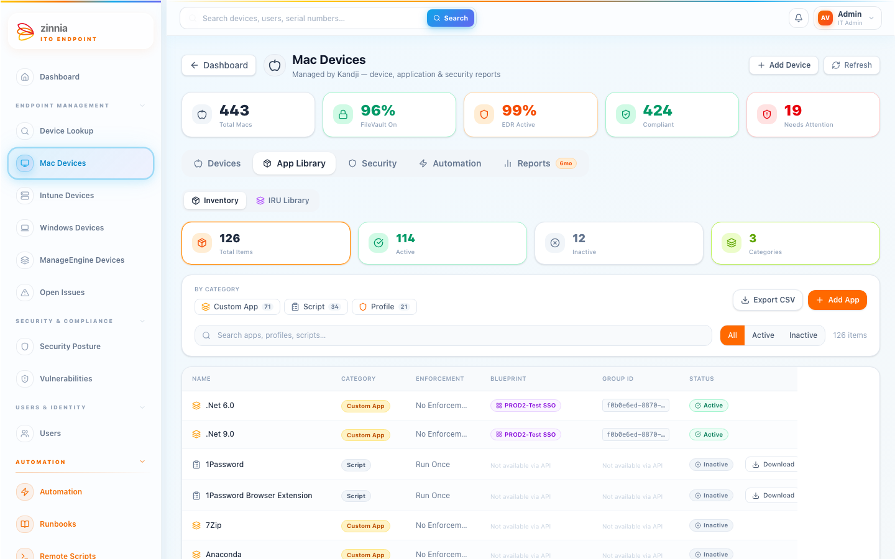

The **App Library** tab provides full visibility into your Kandji-managed application estate. It has two sub-views:

### Sub-Views

| Sub-View | Description |
|----------|-------------|
| **Inventory** | All managed application deployments from your Kandji library |
| **IRU Library** | Full list of Kandji library items including scripts, profiles, and web apps |

### App Library Metrics

Four summary cards appear at the top:

| Metric | Description |
|--------|-------------|
| **Total Items** | Total number of managed library items |
| **Active** | Items currently enforced on at least one blueprint |
| **Inactive** | Items in the library but not assigned to any blueprint |
| **Categories** | Count of distinct app categories in use |

### App Table Columns

| Column | Description |
|--------|-------------|
| **Name** | Application name with category icon |
| **Category** | App type (see categories below) |
| **Enforcement** | How the app is installed/run |
| **Blueprint** | Which Kandji Blueprint the item is assigned to |
| **Group ID** | Internal group/item identifier |
| **Status** | Active or Inactive badge |
| **Actions** | Download script template (.sh) or manage item |

### App Categories

| Category | Color | Description |
|----------|-------|-------------|
| **Auto App** | Orange | Automatically updating VPP apps |
| **Custom App** | Amber | Custom .pkg or .dmg packages |
| **VPP App** | Lime | Apps from Apple Business Manager |
| **Script** | Slate | Bash, Zsh, or Python scripts |
| **Profile** | Orange | MDM configuration profiles |
| **Web App** | Slate | Browser web clips |
| **Printer** | Slate | Printer configurations |

### Enforcement Types

| Type | Behavior |
|------|----------|
| **Continuous** | Re-installed or re-run on every check-in |
| **Install Once** | Installed a single time; not re-installed if removed |
| **Run Once** | Script or command runs once per device |
| **No Enforcement** | Available in Self Service; not auto-deployed |

### Filters & Actions

- **Category filter chips** — narrow the table to a single app category
- **All / Active / Inactive** toggle — filter by deployment status
- **Search** — find apps by name
- **Export CSV** — download the full app inventory as a CSV file
- **+ Add App** — add a new library item to the Kandji Blueprint

---

## 4. Security Tab

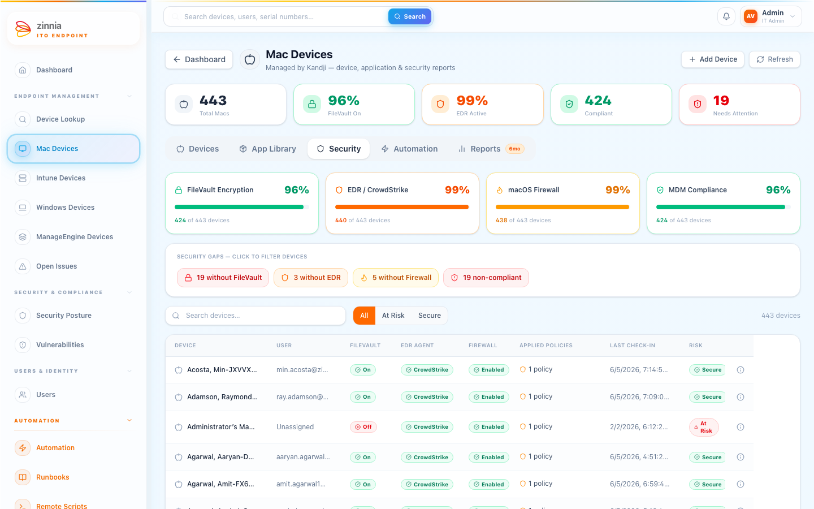

The **Security** tab gives you a device-level security posture view across your entire Mac fleet.

### Security Metric Cards

Four top-level security KPIs are displayed:

| Metric | What it Measures |
|--------|-----------------|
| **FileVault Encryption** | % of devices with FileVault full-disk encryption enabled |
| **EDR / CrowdStrike** | % of devices with an active EDR/antivirus agent installed |
| **macOS Firewall** | % of devices with the built-in macOS Firewall enabled |
| **MDM Compliance** | % of devices passing all MDM compliance policies |

Each card shows the count of affected devices below the percentage (e.g., "426 of 443 devices").

### Security Gaps Panel

A clickable row of security gap chips lets you instantly filter devices with specific security deficiencies:

| Gap | Filter |
|-----|--------|
| **X without FileVault** | Devices missing disk encryption |
| **X without EDR** | Devices lacking an active endpoint protection agent |
| **X without Firewall** | Devices with macOS Firewall disabled |
| **X non-compliant** | Devices failing at least one MDM policy |

Clicking any gap chip filters the security table below to show only those devices.

### Security Table Columns

| Column | Description |
|--------|-------------|
| **Device** | Device name |
| **User** | Assigned user |
| **FileVault** | On / Off badge |
| **EDR Agent** | EDR product name (e.g., CrowdStrike) with Active/Inactive status |
| **Firewall** | Enabled / Disabled badge |
| **Applied Policies** | Number of Kandji policies applied to the device |
| **Last Check-in** | Most recent MDM check-in timestamp |
| **Risk** | Computed risk score (Secure / At Risk) |
| **Actions** | Open Device Detail Panel |

### Filter Bar

The security table supports three toggle filters:

| Filter | Shows |
|--------|-------|
| **All** | Every device |
| **At Risk** | Devices with one or more security gaps |
| **Secure** | Devices passing all security checks |

---

## 5. Automation Tab

The **Automation** tab is reserved for configuring device-level automation rules that trigger based on compliance state changes, check-in events, or policy failures. This integrates with the platform's broader Automation Rules engine.

> See [Automation Rules documentation](../automation-rules.md) for full details.

---

## 6. Reports Tab

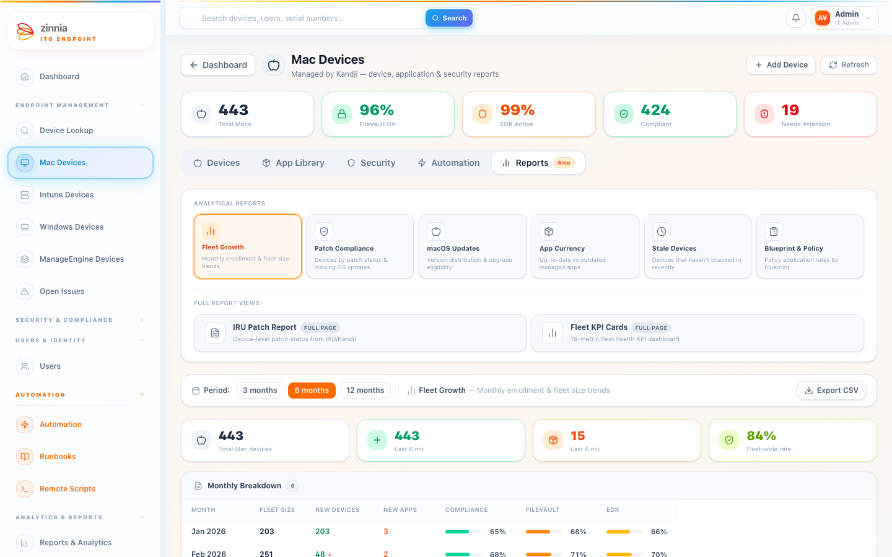

The **Reports** tab provides structured analytics across your Mac fleet, covering fleet growth, patch compliance, and application currency.

### Analytical Report Types

| Report | Description |
|--------|-------------|
| **Fleet Growth** | Monthly enrollment trends and total fleet size over time |
| **Patch Compliance** | Device breakdown by patch status and missing OS updates |
| **macOS Updates** | OS version distribution and upgrade eligibility |
| **App Currency** | Up-to-date vs. outdated managed applications |
| **Stale Devices** | Devices that haven't checked in within a defined threshold |
| **Blueprint & Policy** | Policy application rates per Kandji Blueprint |

### Full Page Reports

Two dedicated full-page report views are available directly from this tab:

| Report | Description |
|--------|-------------|
| **IRU Patch Report** | Device-level patch status pulled from the Kandji IRU library |
| **Fleet KPI Cards** | An 18-metric fleet health dashboard summarizing the full Mac estate |

### Report Controls

| Control | Function |
|---------|----------|
| **Period selector** | Switch between 3-month, 6-month (default), and 12-month windows |
| **Export CSV** | Download the currently displayed report data as a CSV file |

### Monthly Breakdown Table

The default Fleet Growth report renders a month-by-month breakdown table with the following columns:

| Column | Description |
|--------|-------------|
| **Month** | Calendar month |
| **Fleet Size** | Total enrolled Mac count for that month |
| **New Devices** | Net new devices enrolled |
| **New Apps** | New library items added |
| **Compliance** | % compliant devices (color-coded bar) |
| **FileVault** | % FileVault-on devices (color-coded bar) |
| **EDR** | % EDR-active devices (color-coded bar) |

> Drag column edges to resize them. Click "New Devices" or "New Apps" count badges to expand and see added items inline.

---

## 7. Device Detail Panel

The Device Detail Panel slides in from the right when you click on any device row in the Devices or Security tabs. It provides a comprehensive 6-tab deep-dive into a single device.

### Panel Header

| Element | Description |
|---------|-------------|
| **← Mac Devices** | Back link to close the panel and return to the list |
| **Device icon** | Platform icon (Apple) |
| **Device name** | Full device name (e.g., "Administrator's MacBook Pro") |
| **Compliance badge** | Warning / Compliant / Non-Compliant |
| **MDM source** | Kandji pill |
| **Model** | Specific hardware model (e.g., MacBook Pro 14-inch, 2024) |
| **Last sync** | Timestamp of the most recent data sync |

---

### 7.1 Overview Tab

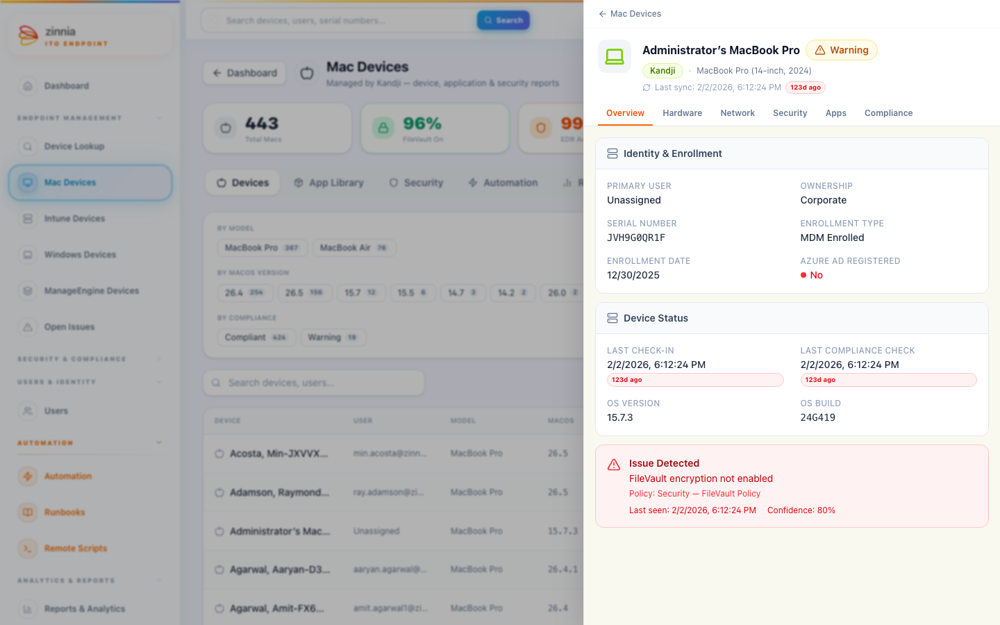

The **Overview** tab presents the device's identity, enrollment details, and current status in one scrollable view.

#### Identity & Enrollment

| Field | Description |
|-------|-------------|
| **Primary User** | Assigned user (or "Unassigned") |
| **Ownership** | Corporate or Personal |
| **Serial Number** | Device serial number |
| **Enrollment Type** | MDM enrollment method (e.g., "MDM Enrolled") |
| **Enrollment Date** | Date the device was first enrolled in Kandji |
| **Azure AD Registered** | Whether the device is registered in Microsoft Entra ID |

#### Device Status

| Field | Description |
|-------|-------------|
| **Last Check-in** | Timestamp with a human-readable recency badge (e.g., "123d ago") |
| **Last Compliance Check** | When MDM last evaluated compliance policies |
| **OS Version** | Running macOS version |
| **OS Build** | Specific build number (e.g., 24G419) |

#### Issue Detected Banner

If a device has an active compliance issue, a highlighted banner appears at the bottom of the Overview tab:

| Field | Description |
|-------|-------------|
| **Issue** | Human-readable description (e.g., "FileVault encryption not enabled") |
| **Failed Policy** | The specific Kandji policy that failed (e.g., "Security — FileVault Policy") |
| **Last Seen** | Timestamp of when the issue was last detected |
| **Confidence** | Model confidence score for the issue detection (e.g., 80%) |
| **Severity** | Medium / High / Critical |

---

### 7.2 Hardware Tab

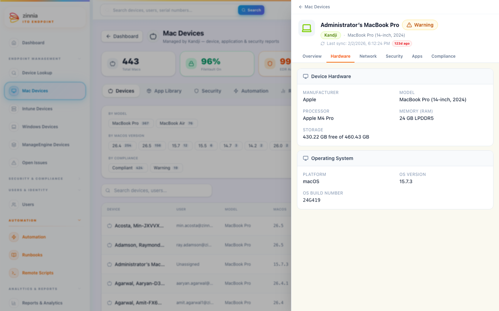

The **Hardware** tab shows the physical and OS specification of the device.

#### Device Hardware

| Field | Example |
|-------|---------|
| **Manufacturer** | Apple |
| **Model** | MacBook Pro (14-inch, 2024) |
| **Processor** | Apple M4 Pro |
| **Memory (RAM)** | 24 GB LPDDR5 |
| **Storage** | 430.22 GB free of 460.43 GB |

#### Operating System

| Field | Example |
|-------|---------|
| **Platform** | macOS |
| **OS Version** | 15.7.3 |
| **OS Build Number** | 24G419 |

---

### 7.3 Network Tab

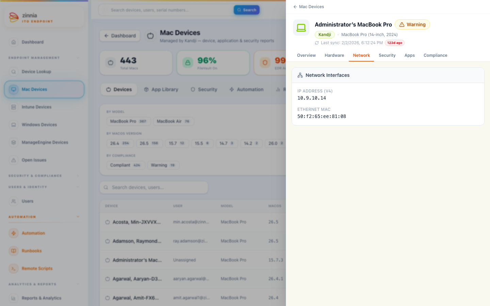

The **Network** tab displays network interface information as reported by Kandji.

#### Network Interfaces

| Field | Description |
|-------|-------------|
| **IP Address** | Current IPv4 address |
| **Ethernet MAC** | Physical MAC address for the wired interface |
| **Wi-Fi MAC** | Physical MAC address for the wireless interface |

---

### 7.4 Security Tab

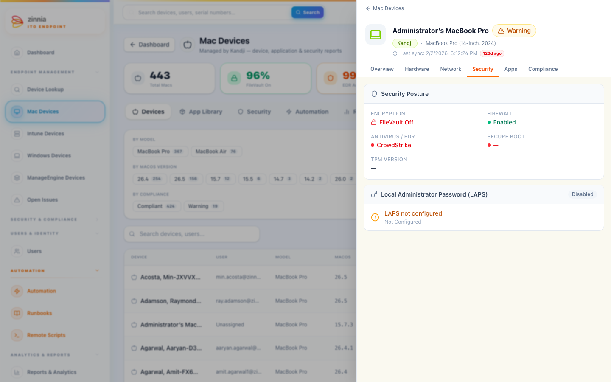

The **Security** tab provides a complete security posture view for the individual device.

#### Security Posture

| Field | Description |
|-------|-------------|
| **Encryption** | FileVault status (On/Off with lock icon) |
| **Firewall** | macOS Firewall status (Enabled/Disabled) |
| **Antivirus / EDR** | EDR agent name and status (e.g., CrowdStrike — Active) |
| **Secure Boot** | Secure Boot status or "Not Applicable" for Apple Silicon |
| **TPM Version** | TPM chip version (Intel Macs) |

#### Local Administrator Password (LAPS)

| Field | Description |
|-------|-------------|
| **Status** | Enabled / Disabled badge |
| **Source** | LAPS provider (e.g., "Microsoft LAPS (Entra)", "Not Configured") |
| **Account Name** | Local admin account managed by LAPS |
| **Last Rotation** | Timestamp of the most recent password rotation |
| **Password Expires At** | Next scheduled expiry |

---

### 7.5 Apps Tab

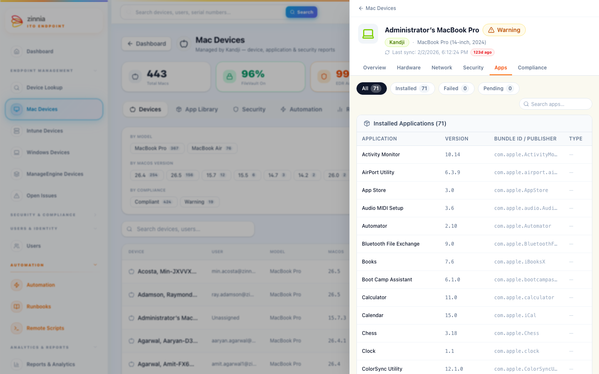

The **Apps** tab lists every application installed on the device, with filtering and search.

#### Summary Filter Bar

| Filter | Shows |
|--------|-------|
| **All** | All installed applications (with total count) |
| **Installed** | Successfully installed apps |
| **Failed** | Apps that failed to install (count in red badge) |
| **Pending** | Apps awaiting installation |

#### App Table Columns

| Column | Description |
|--------|-------------|
| **Application** | App name |
| **Version** | Installed version number |
| **Bundle ID / Publisher** | macOS bundle identifier (e.g., `com.apple.ActivityMonitor`) |
| **Type** | App Store / System / MDM Managed |
| **Installed Date** | When the app was first installed |
| **Status** | Installed (green) / Failed (red) / Pending (amber) |

> Failed installations surface at the top of the list with an **error code badge** and a human-readable error description to accelerate troubleshooting.

---

### 7.6 Compliance Tab

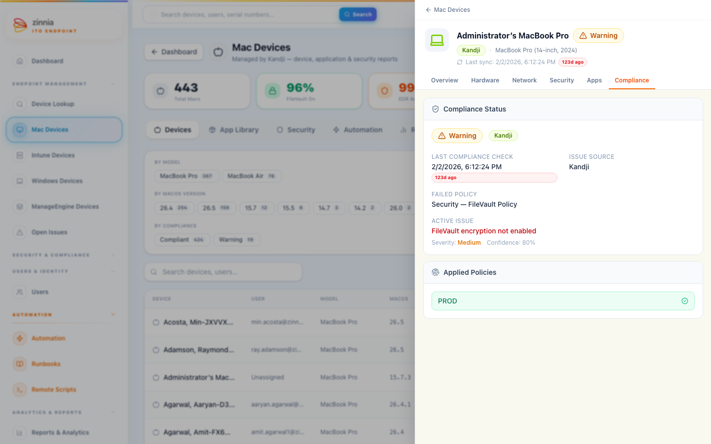

The **Compliance** tab provides the full compliance context for the device — what's failing, which policy governs it, and what action is needed.

#### Compliance Status

| Field | Description |
|-------|-------------|
| **State Badge** | Compliant / Warning / Non-Compliant |
| **Source** | MDM source managing compliance (Kandji pill) |
| **Last Compliance Check** | Timestamp with recency badge |
| **Issue Source** | Which system raised the compliance issue |
| **Failed Policy** | Specific policy name that failed |
| **Active Issue** | Issue description with Severity and Confidence score |

#### Applied Policies

Lists all Kandji policies (Blueprints) applied to the device. Each policy shows:
- Policy name badge (e.g., **PROD**)
- Pass (green checkmark) or Fail (red X) status

---

## 8. Device Lookup

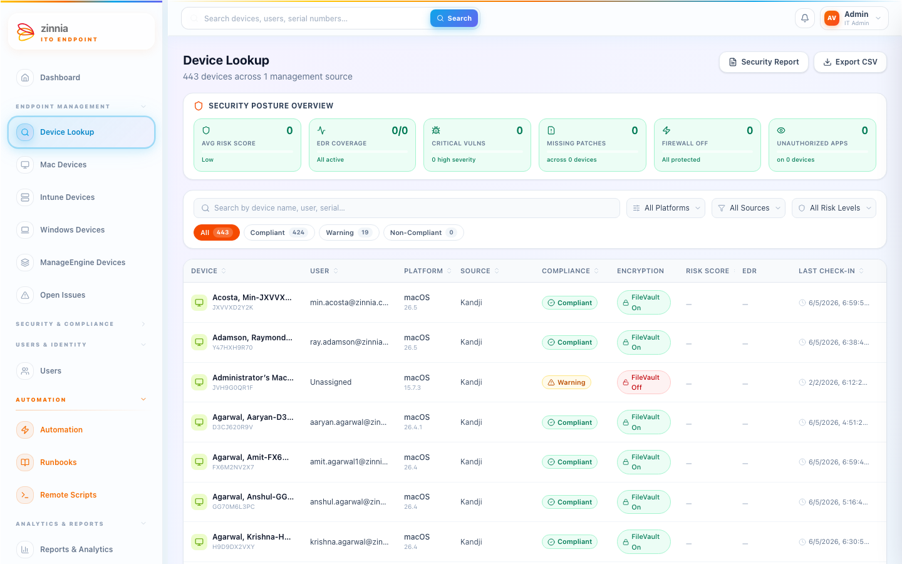

**Device Lookup** is a cross-platform device browser that aggregates devices from all connected MDM sources (Kandji, Intune, ManageEngine) into a single unified view.

> Navigation: **Endpoint Management → Device Lookup**

### Security Posture Overview

A six-tile summary bar at the top of the page shows your aggregate security posture across all platforms:

| Tile | Description |
|------|-------------|
| **Avg Risk Score** | Fleet-wide average device risk score with severity label |
| **EDR Coverage** | Count of active vs. inactive EDR-protected devices |
| **Critical Vulns** | Devices with at least one critical vulnerability |
| **Missing Patches** | Total count of missing patches across the fleet |
| **Firewall Off** | Devices with firewall disabled |
| **Unauthorized Apps** | Devices with unrecognized or policy-violating applications |

### Filters & Search

| Filter | Options |
|--------|---------|
| **Search** | Device name, user, serial number |
| **Platform** | All Platforms, macOS, Windows, Linux |
| **Source** | All Sources, Microsoft Intune, Kandji, ManageEngine |
| **Risk Level** | All, Critical, High, Medium, Low |
| **Compliance** | All, Compliant (emerald), Warning (amber), Non-Compliant (red) |

### Device Table Columns

| Column | Description |
|--------|-------------|
| **Device** | Device name with platform icon; serial number below |
| **User** | Assigned user email |
| **Platform** | OS name with version |
| **Source** | Management system badge |
| **Compliance** | Compliance state badge |
| **Encryption** | Lock icon + FileVault/BitLocker status |
| **Risk Score** | Numeric score with color bar |
| **EDR** | Active / Inactive with dot indicator |
| **Last Check-in** | Most recent check-in timestamp |
| **Actions** | Details button + Sync Now button |

### Actions

| Action | Description |
|--------|-------------|
| **Details** | Opens a side drawer with full device security profile, events, and recommended actions |
| **Sync Now** | Triggers an immediate MDM sync for the selected device |
| **Security Report** | Exports a CSV report with per-device risk profiles, vulnerability counts, and unauthorized apps |
| **Export CSV** | Downloads the full device list in CSV format |

### Pagination

The table is paginated at 10 devices per page with numbered page controls. The footer shows **"X–Y of Z devices"** to confirm the current view scope.

---

## Related Documentation

- [Device Detail Panel — Full Reference](device-detail-panel.md)
- [Kandji Integration Setup](../04-integrations/kandji.md)
- [Security Posture Page](security-posture.md)
- [Automation Rules](automation-rules.md)
- [Runbooks](runbooks.md)

---

*Last updated: June 2026 · ITO Endpoint v2.0 · Managed by Kandji*
