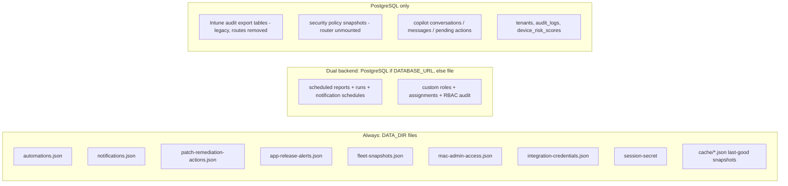
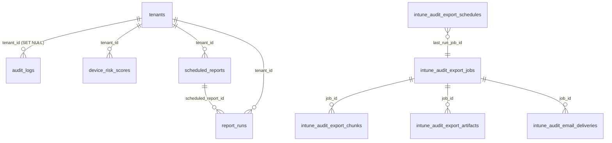

# 09 — Database and Data Handling

> Labels: **Verified** (read in code/schema), **Inferred**, **Not verified**. Related: [02 §7 persistence](02-architecture.md), [08 operations](08-deployment-and-operations.md), [06 security](06-authentication-rbac-security.md).

## 1. Storage model in one picture

The portal works with **no database**. PostgreSQL is optional and, in the code reviewed, adds durability and multi-instance safety for a subset of features. Everything the app writes itself goes to **`DATA_DIR`**.

Which backend is active for each dual-backend store is decided **once at process start** (`USE_DB = isDbAvailable()` in `store/scheduledReportsStore.ts` and `store/rolesStore.ts`). Changing `DATABASE_URL` requires a restart and **does not migrate existing file data** (*Verified: no migration code found*).

## 2. `DATA_DIR`

Resolution (`server/src/store/dataDir.ts`, Verified):

1. `DATA_DIR` if set and writable (created if missing).
2. If it is not writable: falls back to `server/data` and logs an error ("Changes may be lost on the next deploy").
3. Unset: tests use a temp folder; on Windows `%ProgramData%\ito-endpoint`; otherwise `server/data`.

Write safety: `writeFileAtomic` writes to a temp file then renames; stores keep a `.bak` copy and fall back to it when the primary is unreadable. Legacy files (`server/.*.json`, `server/.cache`) are copied into `DATA_DIR` on first start (log lines starting `Migrated`).

| File | Content | Writer | Sensitivity | Retention |
|---|---|---|---|---|
| `automations.json` | Rules and latest 500 executions | `data/mockAutomations.ts` | Internal | Executions capped at 500 |
| `notifications.json` | Bell notifications | `data/notificationStore.ts` | Internal | Not verified |
| `patch-remediation-actions.json` | Patch preview/confirm records (actor e-mail, device ids) | `services/patchRemediationStore.ts` | Internal, contains admin identities | Not verified |
| `app-release-alerts.json` | Release-alert baseline and digest state | `appIntel/releaseAlerts.ts` | Internal | Not verified |
| `fleet-snapshots.json` | One daily snapshot of fleet counts (total, compliant, stale, patch devices, by platform) | `store/fleetSnapshotStore.ts` | Internal | Not verified |
| `mac-admin-access.json` | Latest local-admin report per Mac serial | `services/macAdminAccess.ts` | **Contains device serials and account names** | Reports older than the staleness window are hidden, not deleted (*Inferred*) |
| `integration-credentials.json` | Credentials entered in Settings (if used) | `store/integrationStore.ts` | **Secret. Stored as plain JSON; no encryption found** | Until overwritten |
| `rbac.json` | Custom roles and assignments (file backend) | `store/rolesStore.ts` | Internal | — |
| `scheduled-reports.json` | Schedules, run history (file backend) | `store/scheduledReportsStore.ts` | Contains recipients and channel ids | — |
| `session-secret` | Auto-generated JWT signing key when `SESSION_SECRET` is unset | `services/session.ts` | **Secret** | Until deleted (deleting signs everyone out) |
| `cache/devices-<source>.json` (+`.bak`) | Last-good device list per source | `store/deviceSnapshotStore.ts` | **Contains device names, users, serials** | Overwritten on each good refresh; never overwritten by an empty result |
| `cache/intune-detected-apps.v1.json` | Last good Intune detected-apps read | `appIntel/providers.ts` | Application inventory | Overwritten per successful sync |
| `cache/endpoint-central-app-inventory.v2.json`, `app-cve.v1.json`, `app-requests.v1.json`, `stale-devices.v1.json` | Inventory/CVE/request/stale snapshots | respective services | Internal | CVE entries cached 24 h |

**Protect `DATA_DIR` as sensitive**: restrict NTFS permissions to the service account and administrators; include it in backups; never copy it into a source zip. (Both the credentials file and the session secret live there.)

## 3. PostgreSQL

| Item | Detail (Verified) |
|---|---|
| Driver | `pg` pool, max 20 connections, idle timeout 30 s, connect timeout 2 s (`db/index.ts`) |
| Activation | `DATABASE_URL` present (`isDbAvailable()`); features guard with it |
| TLS | In production `ssl: { rejectUnauthorized: false }` — encrypted, certificate **not validated** |
| Schema | `server/src/db/schema.sql`, **23 tables**, 36 `CREATE INDEX` statements, uses `uuid_generate_v4()` (the `uuid-ossp` extension must exist — whether the script creates it was not checked) |
| Initialisation | `psql "$DATABASE_URL" -f server/src/db/schema.sql` (idempotent `CREATE TABLE IF NOT EXISTS` style) |
| Migrations | **No migration tool or versioned migration files.** Schema changes are manual SQL; see [12 §6](12-change-management.md) |
| Rollback | No down-migrations; take a backup before any change |

### 3.1 Tables

| Group | Tables | Purpose |
|---|---|---|
| Tenancy / audit | `tenants` (has `client_secret` column, comment says "store encrypted in production"), `audit_logs`, `device_risk_scores` | Multi-tenant scaffold, audit rows, cached risk scores. Whether the running app writes to these was **not verified** |
| Reports | `scheduled_reports`, `report_runs`, `notification_schedules`, `schedule_audit_log` | Used by `scheduledReportsStore` when the DB is active |
| Intune audit export (legacy) | `intune_audit_export_jobs`, `_chunks`, `_artifacts`, `_email_deliveries`, `_schedules`, `intune_audit_app_trail` | Routes removed per `.env.example`; tables remain |
| Security policies | `security_policy_sync_runs`, `_snapshots`, `_changes`, `_group_cache` | Used by the unmounted router |
| Copilot | `copilot_conversations`, `copilot_messages`, `copilot_pending_actions` | Chat history and confirmable actions |
| RBAC | `custom_roles`, `user_role_assignments`, `rbac_audit_log` | Used by `rolesStore` when the DB is active |

### 3.2 Relationships (core)

Column-level detail (all tables): read `schema.sql`; this document lists relationships verified from `REFERENCES` clauses only. The `copilot_*`, `security_policy_*` and RBAC relationships were **not** traced here.

### 3.3 Retention

Only one explicit retention setting exists: `retention_days` (default 90) on `intune_audit_export_schedules`. No scheduled purge job for other tables was found. **Not verified** whether any cleanup exists elsewhere.

## 4. Data flow and classification

| Data | Origin | Classification (*Inferred*) | Where it lands |
|---|---|---|---|
| Device name, serial, OS, compliance, last check-in | Intune, ManageEngine | Internal, asset data | Memory cache, `cache/devices-*.json`, reports, Slack uploads |
| User principal name / display name on devices and sign-ins | Intune, Entra | **Personal data (employee PII)** | Same as above, Entra pages, exports |
| Sign-in risk, directory audit events, role changes | Entra | Security-sensitive, personal data | Browser memory only (Role Activity persists nothing) |
| Local admin accounts per Mac | Endpoint Central script | Security-sensitive | `mac-admin-access.json` |
| Credentials, tokens | Admin input / env | Secret | `.env`, `integration-credentials.json`, `session-secret` |
| AI prompts and tool results | Copilot, risk scoring | May include device/user context | Sent to Google / OpenAI; stored in `copilot_*` tables when a DB exists |

Zinnia operates in a regulated insurance context. This portal handles **employee device and identity data, not customer policy data**; no customer PII was found in the code reviewed (*Inferred from the data sources; confirm with Security/Privacy*). Reports posted to Slack and files uploaded there inherit Slack's retention and access rules — restrict channels accordingly.

## 5. Import, export and report generation

| Capability | Behaviour | Code |
|---|---|---|
| Excel / CSV / PDF / PPTX | Generated server-side; Excel has overview and data-quality sheets | `services/reportExporter.ts`, `reportOverview.ts` |
| Application inventory export | `GET /api/app-intel/export` (CSV UTF-8 BOM, XLSX); formula injection neutralised by prefixing risky cells with an apostrophe; only `https://` links written; unknown versions shown as Unknown | `appIntel/exportReport.ts` |
| Stale devices, Entra duplicates, groups, scripts config | Dedicated export endpoints | respective routes |
| Slack upload | External upload flow (`files.getUploadURLExternal`) with Block Kit summary | `services/slack.ts` |
| Import | None found. The portal ingests only from APIs, plus the Mac admin script POST |

## 6. Duplicate, missing, stale and inconsistent data

| Situation | Handling |
|---|---|
| A source fails or times out | Last-good list for that source is served; `failedSources`/`staleSources` flags and a "Source freshness" data-quality warning appear |
| A source returns an empty list | Never saved over a good snapshot |
| Same device in Intune and ManageEngine | Two records unless merged by the view; cross-source comparison uses serial number (automation triggers `agent_missing` / `agent_stale`). Records without serials are not judged |
| Duplicate Entra device objects | Detected by Device ID (High), serial via Intune (High), name + OS family (Medium) — `entraDuplicateDevices.ts` |
| No patch data (MDM-only Mac) | Shown as "not reported", never as zero |
| Unparseable app version | Status "Review required"; never assumed up to date |
| Posture signal not reported | Counted as "not reported", excluded from the pillar score |
| Clock/timezone | Schedules are cron + timezone (`zonedTime.ts`, `lib/timezone.ts`) |

## 7. Backup and recovery

See [08 §7](08-deployment-and-operations.md). In short: back up `DATA_DIR` (excluding nothing — it is small and holds the only copy of schedules, roles and automations) and, if used, the PostgreSQL database. Caches under `cache/` are rebuildable and may be excluded to save space.
